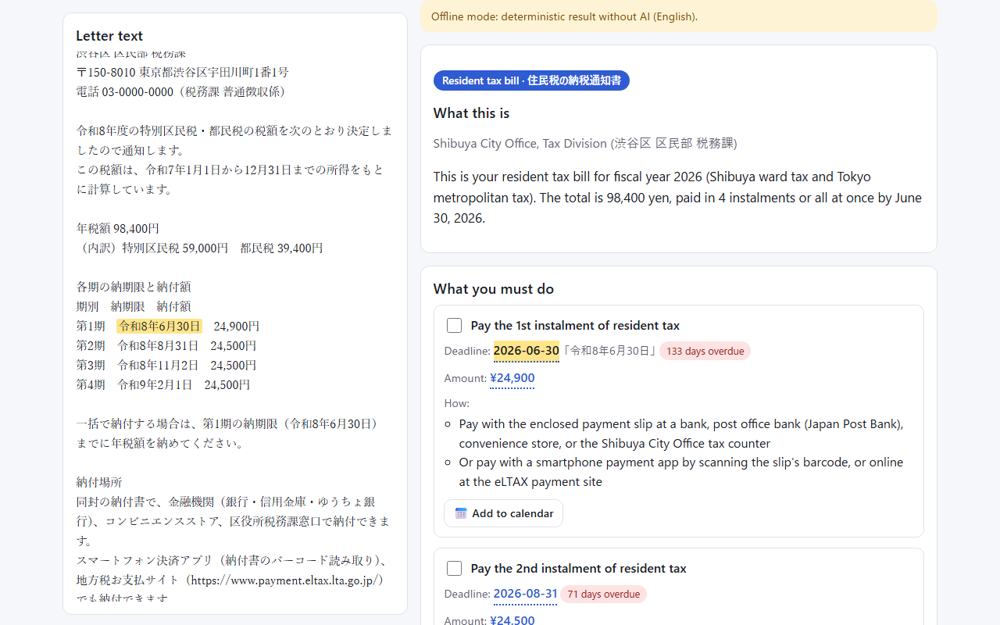
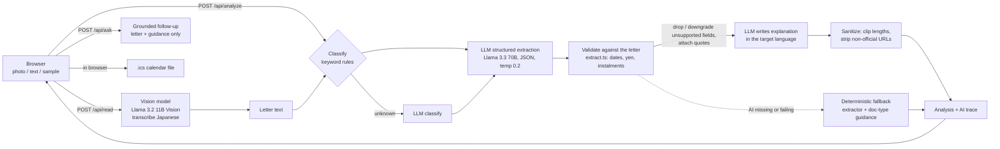

# LetterLens

**Understand letters from Japanese offices.** Photograph or paste a letter from a city office, the pension service or the tax office, and LetterLens explains it in your language: what it is, what you must do and by when, how much to pay, what happens if you ignore it, and the key Japanese terms to use at the counter.

Live: `https://letterlens.<account>.workers.dev` (placeholder until deployed)
Built for SLAY HACKS 2026.



## Why

About 3.9 million foreign residents live in Japan. They get resident tax bills (住民税 納税通知書), National Health Insurance premium notices (国民健康保険料), pension notices (国民年金), My Number card renewal notices and payment reminders (督促状), all written in dense administrative Japanese. Missing a deadline costs money in late fees (延滞金), and in the worst case leads to seizure of salary or savings, or problems when renewing a visa. Machine translation turns the words into English but still leaves the reader to work out what they have to do, by when and where.

## What it does

1. **What this is**: one plain sentence saying who sent the letter and why.
2. **What you must do**: a checklist of actions. Each one has a deadline, an amount and where or how to pay (convenience store, bank, app, ward office), with a countdown.
3. **What happens if you ignore it**: consequences, shown only when the letter itself says so.
4. **Key terms**: the Japanese words on the letter, with furigana readings and meanings.
5. **Ask a follow-up**: up to 3 questions per letter, answered only from the letter and official guidance.
6. **Add to calendar**: an `.ics` file for each deadline with a reminder 3 days before. The file is made in the browser.

Every date and amount links to the exact Japanese words it came from. Tap one and those words are highlighted in the letter text. Fields the checker could not confirm are marked "check this yourself" instead of being guessed.

Output languages: English, Simplified Chinese, Vietnamese, Nepali, Korean, Portuguese, Spanish, Filipino (Tagalog), Indonesian and easy Japanese (やさしい日本語).

## Architecture



- **Cloudflare Worker** (TypeScript, `src/worker.ts`, `src/api.ts`) serves the static page from `public/` and the JSON APIs under `/api/*`. No database, no KV, no file storage.
- **Workers AI**: `@cf/meta/llama-3.2-11b-vision-instruct` reads photos; `@cf/meta/llama-3.3-70b-instruct-fp8-fast` does classification, extraction, writing and follow-ups (`src/models.ts`).
- **Deterministic extractors** (`src/extract.ts`): Japanese era and western dates (令和8年6月30日, 2026年6月30日, 6月30日(火) with the year taken from context, 平成31年/令和元年, full-width digits, ranges), yen amounts (12,300円, ￥12,300) and instalment tables (第1期…第4期). They return character spans.
- **Doc-type classifier and guidance** (`src/doc-types.ts`): resident tax, health insurance, student pension deferral, My Number renewal, payment reminder. Static, sourced guidance on where to pay and which office to ask, with links to official pages.
- **Frontend**: vanilla TypeScript bundled by esbuild into `public/app.js`. Works from 360 px phones up to two-column desktop, supports dark mode and printing, and has an `aria-live` progress list.

## Responsible AI

- **Grounding and validation.** The model proposes dates, amounts and payees. `extract.ts` then checks each one against the letter text. A date or amount that does not appear in the letter is dropped, the action is marked low confidence, and the AI trace records what was dropped and why. Kept facts carry a quote of the exact Japanese span they came from.
- **No guessing.** Missing or low-confidence fields appear as "check this yourself". Consequences are listed only when the letter says them.
- **Prompt-injection hardening.** The letter is wrapped as untrusted data and the system prompts say to ignore any instructions inside it. Output fields are clipped in length, and URLs are removed unless they point to official domains (`*.go.jp`, `*.lg.jp`).
- **Follow-ups are grounded.** The model answers only from the letter and the doc-type guidance. Otherwise it says it doesn't know and points to the ward office. Limited to 3 questions per letter.
- **No storage.** Letters and photos are processed and discarded, and request bodies are never logged. API responses send `Cache-Control: no-store`. Calendar files are made in the browser. See [/privacy](public/privacy.html).
- **Limits.** 8 KB of text, 5 MB images, and an in-memory rate limit of 20 requests per minute per IP.
- **Visible pipeline.** The collapsible AI trace lists every step, the model used, the time taken and any dropped fields.
- **Honest scope.** A banner says this is not legal or tax advice and links official multilingual help: the Foreign Residents Support Center (FRESC) and the Immigration Services Agency's guidebook.
- **If the AI is down.** If the AI binding is missing or a model call fails, the app still returns a deterministic result built from the extractors and the doc-type guidance. The trace marks this as `fallback`.

## Run it offline (no Cloudflare login)

```sh
npm install
npm run build
npm run dev        # wrangler dev -c wrangler.offline.jsonc on http://localhost:8799
```

The offline config has no AI binding, so `/api/analyze` uses the deterministic fallback. The five sample letters work fully. Reading a photo needs the AI, so offline the app asks you to paste the text instead.

With Workers AI (needs a Cloudflare account):

```sh
npx wrangler dev           # wrangler.jsonc, AI binding "AI" (remote)
npx wrangler deploy
```

## Checks

```sh
npm run build
npx tsc --noEmit
npx vitest run                       # extractors, samples, API with a fake AI binding, ics, UI formatting
npm run smoke                        # headless Chromium against the offline server, saves docs/screenshots/
node scripts/record-demo.mjs [baseUrl] [outDir]   # 1280×720 demo recording → demo-out/raw.webm + marks.json
```

## Sample letters

`samples/` has five **synthetic** letters as text and as rendered PNGs: a resident tax bill with 4 instalments, a National Health Insurance premium notice, a student pension deferral notice, a My Number card renewal notice and a tax payment reminder. Each has a hand-checked analysis in `samples/expected/`. Names, addresses, amounts and dates are fictional (fiscal year 2026). The wording follows the public templates municipalities publish. No real person's data is in this repository.

## License

MIT. See [LICENSE](LICENSE).

**Built with Llama.** LetterLens uses Meta Llama 3.2 (11B Vision Instruct) and Llama 3.3 (70B Instruct) through Cloudflare Workers AI. Llama 3.2 is licensed under the [Llama 3.2 Community License](https://www.llama.com/llama3_2/license/), Copyright © Meta Platforms, Inc. All Rights Reserved. Llama 3.3 is licensed under the [Llama 3.3 Community License](https://www.llama.com/llama3_3/license/), Copyright © Meta Platforms, Inc. All Rights Reserved.

LetterLens is an AI helper, not legal or tax advice. Always check the original letter and ask the office that sent it if anything is unclear.
